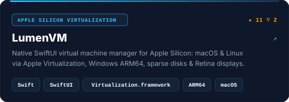
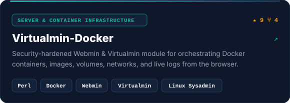
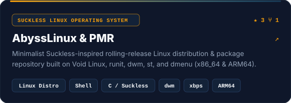
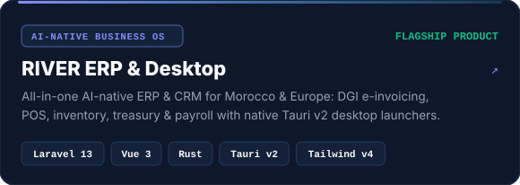
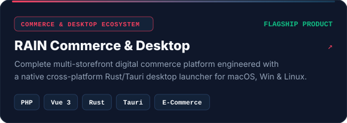
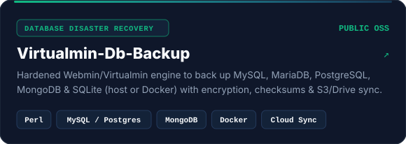
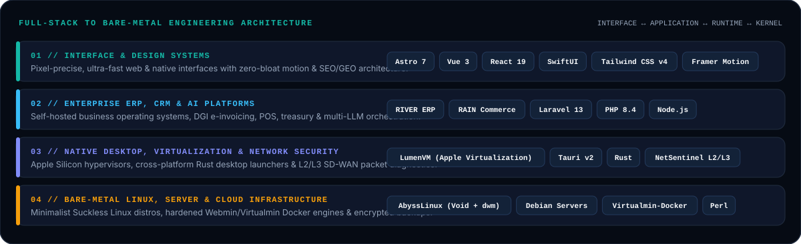
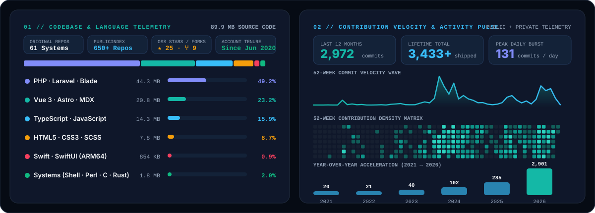

<!-- ╔══════════════════════════════════════════════════════════════════════════════╗ -->
<!-- ║  MrZaKaRiA · Principal Full-Stack, ERP/CRM & Systems Architecture Profile   ║ -->
<!-- ╚══════════════════════════════════════════════════════════════════════════════╝ -->

<div align="center">

<a href="https://mrzakaria.com/">
  <picture>
    <source media="(prefers-color-scheme: dark)" srcset="./assets/hero-dark.svg" />
    <source media="(prefers-color-scheme: light)" srcset="./assets/hero-light.svg" />
    
  </picture>
</a>

<br/>

<!-- Quick Navigation & Live Telemetry Pills -->
<p align="center">
  <a href="https://mrzakaria.com/"></a>
  <a href="https://mrzakaria.com/personal"></a>
  <a href="https://github.com/MrZaKaRiA?tab=repositories"></a>
  <a href="https://github.com/MrZaKaRiA?tab=followers"></a>
  
</p>

<!-- Direct Connect Channels -->
<p align="center">
  <a href="mailto:mrzakaria@me.com"></a>
  <a href="https://x.com/MrZaKaRiA"></a>
  <a href="https://linkedin.com/in/mrzakaria"></a>
  <a href="https://instagram.com/MrZaKaRiA"></a>
  <a href="https://threads.net/@MrZaKaRiA"></a>
  <a href="https://t.me/mrzakaria"></a>
  <a href="https://wa.me/212666580370"></a>
</p>

</div>

---

## ⚡ Engineering Philosophy — *From the Interface to the Infrastructure*

I’m **MrZaKaRiA**, a developer, systems architect, and founder based in **Morocco** building across **high-craft web platforms**, **AI-native ERP & CRM operating systems**, **Apple Silicon virtualization**, and **self-hosted Linux infrastructure**.

- 🏢 **Enterprise Business Systems**: Creator of **RIVER ERP** (AI-native ERP/CRM for Morocco & Europe with DGI e-invoicing, POS, stock, treasury & payroll), **RAIN Commerce**, and **ERPStore**.
- 🖥️ **Native Systems & Virtualization**: Author of **[LumenVM](https://github.com/MrZaKaRiA/LumenVM)** (native SwiftUI virtual machine manager for Apple Silicon), **[AbyssLinux](https://github.com/MrZaKaRiA/AbyssLinux)** (Suckless-inspired Void Linux distribution & package repository), and **NetSentinel** (24/7 Rust L2/L3 network topology & SD-WAN diagnostic engine).
- 🐳 **Server & Cloud Automation**: Maintainer of hardened Webmin/Virtualmin modules (**[Virtualmin-Docker](https://github.com/MrZaKaRiA/Virtualmin-Docker)**, **[Virtualmin-Db-Backup](https://github.com/MrZaKaRiA/Virtualmin-Db-Backup)**, **[Virtualmin-File-Backup](https://github.com/MrZaKaRiA/Virtualmin-File-Backup)**) powering self-hosted Debian servers.

> [!TIP]
> **Open for Select Architecture, Product Engineering & Consulting:** Exploring a new ERP/CRM deployment, a high-velocity web platform, or custom infrastructure tooling? Visit **[mrzakaria.com](https://mrzakaria.com/)** or **[mrzakaria.com/personal](https://mrzakaria.com/personal)**.

---

## 🚀 Flagship Open-Source & Product Bento

<table align="center" width="100%">
<tr>
<td width="50%" valign="top">
  <a href="https://github.com/MrZaKaRiA/LumenVM">
    <picture>
      <source media="(prefers-color-scheme: dark)" srcset="./assets/card-lumenvm-dark.svg" />
      <source media="(prefers-color-scheme: light)" srcset="./assets/card-lumenvm-light.svg" />
      
    </picture>
  </a>
</td>
<td width="50%" valign="top">
  <a href="https://github.com/MrZaKaRiA/Virtualmin-Docker">
    <picture>
      <source media="(prefers-color-scheme: dark)" srcset="./assets/card-virtualmin-docker-dark.svg" />
      <source media="(prefers-color-scheme: light)" srcset="./assets/card-virtualmin-docker-light.svg" />
      
    </picture>
  </a>
</td>
</tr>
<tr>
<td width="50%" valign="top">
  <a href="https://github.com/MrZaKaRiA/AbyssLinux">
    <picture>
      <source media="(prefers-color-scheme: dark)" srcset="./assets/card-abysslinux-dark.svg" />
      <source media="(prefers-color-scheme: light)" srcset="./assets/card-abysslinux-light.svg" />
      
    </picture>
  </a>
</td>
<td width="50%" valign="top">
  <a href="https://github.com/MrZaKaRiA/river-desktop">
    <picture>
      <source media="(prefers-color-scheme: dark)" srcset="./assets/card-river-erp-dark.svg" />
      <source media="(prefers-color-scheme: light)" srcset="./assets/card-river-erp-light.svg" />
      
    </picture>
  </a>
</td>
</tr>
<tr>
<td width="50%" valign="top">
  <a href="https://github.com/MrZaKaRiA/rain-desktop">
    <picture>
      <source media="(prefers-color-scheme: dark)" srcset="./assets/card-rain-commerce-dark.svg" />
      <source media="(prefers-color-scheme: light)" srcset="./assets/card-rain-commerce-light.svg" />
      
    </picture>
  </a>
</td>
<td width="50%" valign="top">
  <a href="https://github.com/MrZaKaRiA/Virtualmin-Db-Backup">
    <picture>
      <source media="(prefers-color-scheme: dark)" srcset="./assets/card-virtualmin-db-backup-dark.svg" />
      <source media="(prefers-color-scheme: light)" srcset="./assets/card-virtualmin-db-backup-light.svg" />
      
    </picture>
  </a>
</td>
</tr>
</table>

---

## 🏗️ Full-Stack to Bare-Metal Architecture

<div align="center">

<picture>
  <source media="(prefers-color-scheme: dark)" srcset="./assets/architecture-dark.svg" />
  <source media="(prefers-color-scheme: light)" srcset="./assets/architecture-light.svg" />
  
</picture>

</div>

---

## 📊 Live Engineering Telemetry & Contribution Pulse

<div align="center">

<picture>
  <source media="(prefers-color-scheme: dark)" srcset="./assets/telemetry-dark.svg" />
  <source media="(prefers-color-scheme: light)" srcset="./assets/telemetry-light.svg" />
  
</picture>

<br/><br/>

<!-- Automated 12-Hour Contribution Grid Snake (Platane/snk on `output` branch) -->
<picture>
  <source media="(prefers-color-scheme: dark)" srcset="https://raw.githubusercontent.com/MrZaKaRiA/MrZaKaRiA/output/github-contribution-grid-snake-dark.svg" />
  <source media="(prefers-color-scheme: light)" srcset="https://raw.githubusercontent.com/MrZaKaRiA/MrZaKaRiA/output/github-contribution-grid-snake.svg" />
  
</picture>

</div>

---

## 🔍 Deep-Dive Explorers

<details>
<summary><b>🗂️ Complete Open-Source &amp; Flagship Systems Directory (Click to expand)</b></summary>
<br/>

| System / Repository | Domain | Core Stack | Highlights |
| :--- | :--- | :--- | :--- |
| **[LumenVM](https://github.com/MrZaKaRiA/LumenVM)** | Apple Silicon Hypervisor | `Swift` · `SwiftUI` · `Virtualization` | macOS & Linux VMs, experimental Windows ARM64, sparse disks, Retina displays, per-VM Dock icons |
| **[Virtualmin-Docker](https://github.com/MrZaKaRiA/Virtualmin-Docker)** | Server & Container Management | `Perl` · `Docker` · `Webmin` | Browser-based container orchestration, image/volume/network controls & security hardening |
| **[AbyssLinux](https://github.com/MrZaKaRiA/AbyssLinux)** | Linux Distribution | `Shell` · `C` · `Void Linux` · `runit` | Suckless-inspired rolling-release OS with `dwm`, `st`, `dmenu` for `x86_64` & `aarch64` |
| **[AbyssLinuxPMR](https://github.com/MrZaKaRiA/AbyssLinuxPMR)** | Package Repository | `xbps` · `xbps-src` · `Shell` | Official binary & source package repository powering AbyssLinux installations |
| **[river-desktop](https://github.com/MrZaKaRiA/river-desktop)** | AI-Native ERP & CRM OS | `Rust` · `Tauri v2` · `Laravel 13` · `Vue 3` | Native macOS (ARM64), Windows & Linux desktop client for RIVER ERP (DGI e-invoicing, POS, payroll) |
| **[rain-desktop](https://github.com/MrZaKaRiA/rain-desktop)** | Digital Commerce Suite | `Rust` · `Tauri` · `PHP` · `Vue 3` | Cross-platform desktop launcher and storefront controller for the RAIN commerce platform |
| **[Virtualmin-Db-Backup](https://github.com/MrZaKaRiA/Virtualmin-Db-Backup)** | Database Disaster Recovery | `Perl` · `MySQL` · `PostgreSQL` · `MongoDB` | Encrypted, checksum-verified host & Docker DB backups with S3, Dropbox & Google Drive upload |
| **[Virtualmin-File-Backup](https://github.com/MrZaKaRiA/Virtualmin-File-Backup)** | Server Backup Automation | `Perl` · `Webmin` · `Virtualmin` | Automated `public_html` and virtual-server archive snapshots for multi-tenant Linux hosts |
| **[ps1](https://github.com/MrZaKaRiA/ps1)** | Terminal Ergonomics | `Shell` · `Bash` · `Zsh` | Zero-latency Linux & macOS terminal prompt customization for SSH and local workstations |
| **[AutomatedMySQLBackup](https://github.com/MrZaKaRiA/AutomatedMySQLBackup)** | Cloud DB Sync | `Shell` · `MySQL` · `Rclone` | Cron-friendly MySQL dump rotation with automated off-site Rclone cloud synchronization |

</details>

<details>
<summary><b>🛠️ Full Technology Radar, AI Orchestration &amp; Workstation Specs (Click to expand)</b></summary>
<br/>

<div align="center">

#### Core Languages &amp; Systems Programming


#### Web, Application &amp; Native Frameworks


#### Databases, Infrastructure &amp; Linux Administration


#### AI &amp; Multi-LLM Engineering Stack


</div>

</details>

<details>
<summary><b>⚡ Terminal Quick-Start — Clone &amp; Run Flagship Open-Source Tools (Click to expand)</b></summary>
<br/>

```bash
# 1. LumenVM — Native Apple Silicon VM Manager (SwiftUI + Virtualization.framework)
git clone https://github.com/MrZaKaRiA/LumenVM.git && cd LumenVM
swift build -c release

# 2. Virtualmin-Docker — Hardened Webmin/Virtualmin Docker Orchestration Module
git clone https://github.com/MrZaKaRiA/Virtualmin-Docker.git

# 3. AbyssLinux — Suckless-inspired Void Linux Distribution & Package Builder
git clone https://github.com/MrZaKaRiA/AbyssLinux.git
```

</details>

---

<div align="center">

<a href="https://mrzakaria.com/">
  <picture>
    <source media="(prefers-color-scheme: dark)" srcset="./assets/footer-dark.svg" />
    <source media="(prefers-color-scheme: light)" srcset="./assets/footer-light.svg" />
    
  </picture>
</a>

</div>
