<!-- Rendered by scripts/generate_profile.py — edit the generator, not the SVGs. -->

<a href="https://mrzakaria.com"><picture><source media="(prefers-color-scheme: dark)" srcset="./assets/hero-dark.svg" /><source media="(prefers-color-scheme: light)" srcset="./assets/hero-light.svg" /></picture></a>

 

I'm a founder and engineer based in Morocco. I work the whole stack, and I mean the whole stack: the ERP a shop runs its day on, the desktop app it opens, the Linux box that serves it, and the hypervisor I test it all in.

Most of what I build is for businesses that would rather own their software than rent it. Self-hosted, fast, and boring in the places that should be boring.

 

<picture>
    <source media="(prefers-color-scheme: dark)" srcset="./assets/section-01-dark.svg" />
    <source media="(prefers-color-scheme: light)" srcset="./assets/section-01-light.svg" />
    
  </picture>

<a href="https://github.com/MrZaKaRiA/LumenVM"><picture><source media="(prefers-color-scheme: dark)" srcset="./assets/card-lumenvm-dark.svg" /><source media="(prefers-color-scheme: light)" srcset="./assets/card-lumenvm-light.svg" /></picture></a>
<a href="https://github.com/MrZaKaRiA/AbyssLinux"><picture><source media="(prefers-color-scheme: dark)" srcset="./assets/card-abysslinux-dark.svg" /><source media="(prefers-color-scheme: light)" srcset="./assets/card-abysslinux-light.svg" /></picture></a>
<a href="https://github.com/MrZaKaRiA/river-desktop"><picture><source media="(prefers-color-scheme: dark)" srcset="./assets/card-river-dark.svg" /><source media="(prefers-color-scheme: light)" srcset="./assets/card-river-light.svg" /></picture></a>
<a href="https://github.com/MrZaKaRiA/Virtualmin-Docker"><picture><source media="(prefers-color-scheme: dark)" srcset="./assets/card-virtualmin-docker-dark.svg" /><source media="(prefers-color-scheme: light)" srcset="./assets/card-virtualmin-docker-light.svg" /></picture></a>
<a href="https://github.com/MrZaKaRiA/rain-desktop"><picture><source media="(prefers-color-scheme: dark)" srcset="./assets/card-rain-dark.svg" /><source media="(prefers-color-scheme: light)" srcset="./assets/card-rain-light.svg" /></picture></a>
<a href="https://github.com/MrZaKaRiA/Virtualmin-Db-Backup"><picture><source media="(prefers-color-scheme: dark)" srcset="./assets/card-db-backup-dark.svg" /><source media="(prefers-color-scheme: light)" srcset="./assets/card-db-backup-light.svg" /></picture></a>

 

<picture>
    <source media="(prefers-color-scheme: dark)" srcset="./assets/section-02-dark.svg" />
    <source media="(prefers-color-scheme: light)" srcset="./assets/section-02-light.svg" />
    
  </picture>

<picture>
    <source media="(prefers-color-scheme: dark)" srcset="./assets/ledger-dark.svg" />
    <source media="(prefers-color-scheme: light)" srcset="./assets/ledger-light.svg" />
    
  </picture>

 

<picture>
    <source media="(prefers-color-scheme: dark)" srcset="./assets/section-03-dark.svg" />
    <source media="(prefers-color-scheme: light)" srcset="./assets/section-03-light.svg" />
    
  </picture>

 

**[mrzakaria.com](https://mrzakaria.com)** &nbsp;·&nbsp; [mrzakaria@me.com](mailto:mrzakaria@me.com) &nbsp;·&nbsp; [X](https://x.com/MrZaKaRiA) &nbsp;·&nbsp; [LinkedIn](https://linkedin.com/in/mrzakaria) &nbsp;·&nbsp; [Telegram](https://t.me/mrzakaria)

Taking on a few ERP/CRM deployments, product builds and infrastructure projects at a time.

  

<a href="https://mrzakaria.com"><picture><source media="(prefers-color-scheme: dark)" srcset="./assets/footer-dark.svg" /><source media="(prefers-color-scheme: light)" srcset="./assets/footer-light.svg" /></picture></a>

